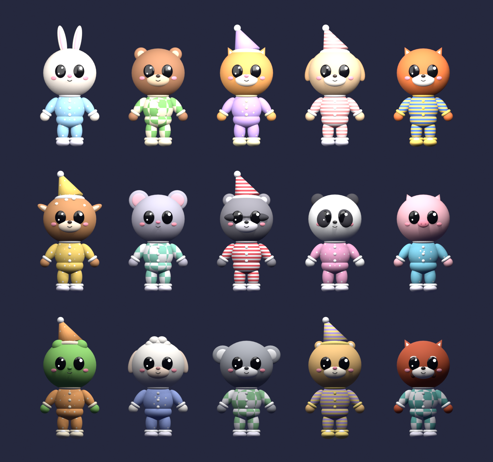

# Guest kids

The 15 animal kids who sleep in the bedrooms. They're original characters in a chunky, big-eyed style, wearing cozy pajamas.

| Name | Animal | Pajamas | Nightcap |
|---|---|---|---|
| Pip | Bunny | Sky blue, dots | |
| Bramble | Bear cub | Green, checks | |
| Mochi | Kitten | Lilac, stars | Yes |
| Biscuit | Puppy | Pink, stripes | Yes |
| Ember | Fox | Blue and yellow stripes | |
| Clover | Fawn | Yellow, dots | Yes |
| Nibbles | Mouse | Mint, checks | |
| Bandit | Raccoon | Red, stripes | Yes |
| Dumpling | Panda | Pink, dots | |
| Truffle | Piglet | Aqua, stars | |
| Lily | Frog | Orange, dots | Yes |
| Cotton | Lamb | Periwinkle, stars | |
| Gumtree | Koala | Green, checks | |
| Peanut | Hamster | Lavender and yellow stripes | Yes |
| Maple | Red panda | Teal, checks | |

## Files

- `guests.blend`: all 15 kids, each in its own collection with an R15-style rig (bones named like Roblox R15 parts).
- `fbx/`: one FBX per kid, centred at the origin, for Roblox Studio's 3D Importer.
- `renders/`: a portrait of each kid, the lineup, and `in_bed.png` showing a kid tucked into a bed.
- `make_guests.py` and `render_all.py`: the scripts that build everything. Edit a kid's colors or ears in the `KIDS` list, then run `blender -b guests.blend --python render_all.py` to rebuild.

The pajama patterns (dots, stripes, checks, stars) are Blender shader patterns, so the FBX files carry the main pajama color only. Bake them to textures before the final Roblox import if you want the patterns in game.
